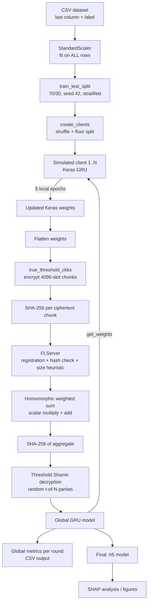

# SecureFed-IDS — Phase 1 Project Analysis

Status: Phase 1 inspection only. No dependencies installed, no research file modified,
no application code built.

## 1. Paths and evidence

The paths in the brief (`C:-IDS`, `C:-IDS-fl-ids-sdn`, `C:-IDS-web`) do not exist as
written. The actual local locations are:

| Brief | Actual local path |
|---|---|
| Parent `C:-IDS` | `C:\Users\HARIS\Desktop\SecureFed-IDS` |
| Research repository `C:-IDS-fl-ids-sdn` | `C:\Users\HARIS\Desktop\SecureFed-IDS\threshold-fl-ids-sdn` |
| New application `C:-IDS-web` | `C:\Users\HARIS\Desktop\SecureFed-IDS\web` (created for these documents) |

Repository facts:

- Git remote: `https://github.com/ictshamim09/threshold-fl-ids-sdn.git`
- Current HEAD: `69b9ba9 Upload clean reproducibility files`
- Tracked source files: eight model scripts, `Figure Generation.py`, `shapupdates.py`
- `README`, `requirements.txt`, dataset files, trained models, and result CSVs are **absent**
- `.gitignore` contains only `*.so`
- The brief lists `CICDDoS19_4.py`; the repository actually contains `CICDDoD19_4.py`
  (typo in the filename). This analysis uses the real filename.
- Notebooks were removed from HEAD (`53d70d3` → `69b9ba9`), but old notebooks remain in
  Git history and contain execution logs. Those logs are treated as **historical
  evidence only**, not as proof that the current `.py` files reproduce the results.

## 2. Executive summary

The repository is a collection of exported Jupyter scripts that simulate a
threshold-federated-learning experiment. It does not contain a runnable application,
independent clients, networking, a service API, a frontend, a test suite, or IPS/SDN
integration.

What genuinely exists in source:

- A three-layer GRU binary classifier.
- In-process dataset loading, scaling, splitting, and sharding.
- A simulated federated loop with local training and a server object.
- Calls into a native `true_threshold_ckks` extension for DKG-based threshold CKKS
  encryption, homomorphic weighted aggregation, and Shamir threshold decryption.
- SHA-256 integrity checks over ciphertext chunks and the aggregated ciphertext.
- A size-based Byzantine heuristic and a client blacklist.
- SHAP/KernelExplainer analysis in the InSDN scripts; SHAP/GradientExplainer stability
  analysis in `shapupdates.py`; ROC/confusion-matrix figure generation.

What does not exist:

- Real independent clients, real network transport, client isolation, or a real server.
- Authentication, replay protection, signatures, or a verifiable trust boundary.
- A working CKKS extension in this workspace (the Linux `.so` was removed from HEAD).
- Datasets, model artifacts, result files, dependency pinning, tests, or CI.
- Any SDN controller integration, mitigation logic, or IPS behavior.

Historical notebook output (`InSDN_4.ipynb` at commit `53d70d3`) shows the author once ran
the InSDN 4-client workflow to completion on Linux/Python 3.8 with an RTX 3090:
`[HE Manager] DKG complete`, 15 communication rounds, `Aggregated hash verified`, and
final reported accuracy `99.952%`. Those numbers are quoted as historical logs, not as
independently reproduced results. The notebook's own cell outputs are internally
inconsistent (different cells show 5,165 and 6,694 test batches), so the log is of unknown
contiguity and may contain stale outputs from multiple runs.

## 3. Architecture actually implemented

Every box runs inside one Python process. The "clients", the "server", and every
decryption party share one address space. There is no socket, RPC, HTTP, or database.

## 4. Exact research workflow currently implemented

Entry point is the top-level body of each script; there are no `main()` functions or CLI
arguments. Working directory must be the repository root.

1. Load a CSV with `load_csv_data`: all columns except the last are features, the last
   column is the label.
2. Fit `StandardScaler` on the **entire** dataset, then split 70/30 with
   `random_state=42` and `stratify=labels`.
3. Reshape to `(samples, 1, features)` for the GRU.
4. Shuffle the training rows and divide them into `num_clients` shards with
   `create_clients`; the remainder is dropped.
5. Build the global GRU and initialise `TrueThresholdCKKSWrapper`, which calls the native
   library's DKG phases and Shamir key construction.
6. Register each client with the server (integer IDs `0..N-1`).
7. For each of 15 rounds:
   - On rounds after the first, select `threshold` random parties and threshold-decrypt
     the previous encrypted aggregate; assign those weights to the global model.
   - For every client, rebuild a GRU, load the current global weights, train for 5
     epochs on that client's shard, flatten the resulting weights, encrypt them in
     4096-slot chunks, and hash each ciphertext chunk.
   - The server checks registration and per-chunk hashes, then applies a ciphertext-size
     outlier check.
   - The server computes a weighted homomorphic sum using dataset-size scaling factors.
   - The aggregate ciphertext is hashed and verified, then threshold-decrypted and
     assigned to the global model.
   - Global metrics are written and printed.
8. Save the final global model as `dkg_Federated_model_4.h5` (the `_4` suffix is used by
   every client-count variant).
9. Train a one-epoch centralised baseline for comparison.
10. In the InSDN scripts only, run KernelExplainer SHAP analysis and save plots.

Storage is append-only CSV files inside a per-run directory plus one final `.h5` model.
There is no checkpoint per round, no model registry, and no run manifest.

## 5. Component findings (required investigation topics)

### 5.1 GRU architecture

`build_gru_model` (`InSDN_4.py:209-222`, identical in all model scripts):

- Input shape `(1, n_features)`.
- `GRU(256, return_sequences=True)`, BatchNormalization, Dropout 0.3.
- `GRU(128, return_sequences=True)`, BatchNormalization, Dropout 0.3.
- `GRU(64, return_sequences=False)`, BatchNormalization, Dropout 0.3.
- `Dense(1, sigmoid)`.
- Adam with the per-script learning rate, binary cross-entropy, accuracy metric.

With 48 features the parameter count is approximately 422k, which matches the historical
log line `104 chunks` (104 × 4096 slots ≥ 422,337). Feature count is never validated
against 48; it is read from the CSV.

### 5.2 Dataset loading and preprocessing

- `load_csv_data` (`InSDN_4.py:228-232`) assumes a numeric CSV with the label in the last
  column. No schema, missing-value, or label validation exists.
- `StandardScaler` is fitted before the train/test split (`InSDN_4.py:465-469`), so test
  statistics influence training preprocessing. This is data leakage and affects reported
  results.
- Split: 30% test, `random_state=42`, stratified.
- Input reshape: one timestep.
- Dataset paths:
  - InSDN scripts: `../Final_Binary_InSDN_Dataset.csv`
  - CICDDoS17 scripts: `../final_cicids2017_top48_features.csv`
  - CICDDoS19 scripts: `../final_cicids2019_top48_features.csv`
- None of these CSV files are present in the repository.
- Each file contains an unused `InSDNDataset` class. In the InSDN files it reads
  `final_cicids2017_top48_features.csv`; in the CICDDoS17 files it reads the 2019 file and
  vice versa. It is dead code and is inconsistent with the main path.
- `Figure Generation.py` and `shapupdates.py` repeat the same whole-dataset scaler fit and
  the same seed/split so they can reconstruct the test set.

### 5.3 Local training and artifacts

- Local training rebuilds a fresh Keras model each round, copies the current global
  weights, and fits for 5 epochs with batch size 32 (`InSDN_4.py:605-609`).
- `tf.keras.backend.clear_session()` is called after every client.
- Only the final global model is saved: `dkg_Federated_model_4.h5` (`InSDN_4.py:772`).
- Per-client CSV columns claim precision, recall, and AUC, but the writer stores `0, 0, 0`
  for them (`InSDN_4.py:633-638`). Only training loss/accuracy and encryption/decryption
  times are real.
- `test_model` returns `0` in place of AUC (`InSDN_4.py:270`), and AUC is not in the global
  CSV. AUC is recomputed later in `Figure Generation.py`.

### 5.4 Client construction: simulated, not independent

- `create_clients` (`InSDN_4.py:234-240`) shuffles one in-memory training set and slices
  it. All clients are Python objects in one process.
- No client owns a private data store or a separate runtime.
- No network protocol exists.
- All clients participate in every round; there is no client sampling.
- The "server" is an in-process object.

There is a concrete ID bug: `client_idx = client_names.index(client)`
(`InSDN_4.py:602`) derives the server ID from the current list position, but
`random.shuffle(client_names)` mutates that list each round (`InSDN_4.py:591`). After the
first shuffle, server-side IDs no longer identify the same client; hash records,
suspicion sets, and blacklisting can be attributed to the wrong participant.

### 5.5 Local update generation and weight handling

- Weights are flattened and concatenated in Keras layer order, then split into
  4096-value chunks (`encrypt_weights`, `InSDN_4.py:418-427`).
- Each chunk is padded to the CKKS batch size before encryption.
- Decryption concatenates decrypted chunks and reshapes them using the reference model's
  weight shapes; padded tail values are ignored (`InSDN_4.py:430-442`).
- Scaling factors are computed from the number of **batches** times 32, not the number of
  samples (`weight_scaling_factor`, `InSDN_4.py:247-256`). The final partial batch is
  counted as a full batch, so the factors are approximate. In the historical 4-client run
  they were all `0.2500`.

### 5.6 Federated aggregation and weighting

- `FLServer.weighted_aggregate_encrypted` (`InSDN_4.py:371-412`) performs
  `Σ scaling_factor_i × ciphertext_i` using homomorphic scalar multiplication and
  addition.
- There is no FedAvg momentum, no robust aggregation, no clipping, and no normalisation
  beyond the scaling factors.
- The server never decrypts. Decryption is performed in the client-side part of the same
  simulation via threshold parties.
- If the aggregate is `None` the round is skipped; if the post-aggregation hash fails the
  round is skipped.

### 5.7 Global model creation and distribution

- The global model is a normally initialised Keras GRU (`InSDN_4.py:519`).
- Round 0 trains clients from that random initialisation.
- Later rounds decrypt the previous aggregate, assign it to the global model, and send it
  to clients by copying weights in memory (`InSDN_4.py:562-607`).
- Distribution is not authenticated and not persisted per round.

### 5.8 CKKS encryption/decryption calls

`TrueThresholdCKKSWrapper` (`InSDN_4.py:65-180`) calls:

- `TrueThresholdCKKS(...)` with `ring_dim=8192`, `batch_size=4096`, `mult_depth=2`,
  `scale_bits=40`.
- DKG: `dkg_lead_keygen`, `dkg_join_keygen`, `dkg_finalize_public_key`,
  `dkg_evalmult_keygen`, `dkg_evalmult_join`, `dkg_evalmult_finalize`.
- Shamir: `generate_key_shares`, `construct_party_key`, `partial_decrypt_shamir`,
  `combine_partial_decryptions`.
- Data path: `encrypt`, `add_encrypted`, `multiply_by_scalar`.

The wrapper's own comments claim the combined secret is never assembled. In the Python
simulation, however, every party's shares are generated and summed in one process
(`InSDN_4.py:115-133`), so that process holds enough material to reconstruct the
threshold key. The security claim is therefore not demonstrated by the current
simulation and would require separate trust domains to be meaningful.

### 5.9 Missing `true_threshold_ckks` dependency

- The extension was deliberately deleted from HEAD in commit `97ea3ee`.
- It exists in history as `true_threshold_ckks.cpython-38-x86_64-linux-gnu.so`
  (2,490,456 bytes).
- Binary inspection (read-only; not executed) shows:
  - CPython 3.8, x86-64, Linux (`cpython-38-x86_64-linux-gnu`).
  - Built with GCC 9.4.0 on Ubuntu 20.04.
  - Requires GLIBC 2.29+.
  - Links `libOPENFHEcore.so.1`, `libOPENFHEpke.so.1`, `libstdc++.so.6`, `libm.so.6`,
    `libgcc_s.so.1`, `libc.so.6`.
  - Built on OpenFHE (`lbcrypto`), using pybind11 and cereal.
  - Embedded messages include `[TrueThresholdCKKS] Context ready`,
    `mode=NOISE_FLOODING_MULTIPARTY`, `[DKG] Joint public key finalized`,
    `[Shamir] ...`.
- It cannot be imported on this Windows machine, and no Python interpreter is currently
  installed or usable here. The repository contains no build script, header, or source for
  this extension.
- Consequence: every encryption, aggregation, and decryption path is currently
  **blocked**. The current code cannot run end-to-end on this machine.

### 5.10 SHA-256 usage

- `compute_hash` and `verify_hash` (`InSDN_4.py:36-41`).
- Used for per-chunk ciphertext hashes (`InSDN_4.py:426`) and for the concatenated
  aggregate (`InSDN_4.py:404-412`, verification at `445-446`).
- This provides an integrity check inside one process. It is **not** a signature, MAC, or
  authenticated channel. Because the hash travels with the ciphertext and there is no
  secret/signature, an adversary who can modify an update can modify its hash too.
- Hashes do not protect raw datasets (raw data never leaves the simulated client shards).

### 5.11 Authentication, replay protection, Byzantine validation

- Registration: `register_client` creates a token and stores it
  (`InSDN_4.py:321-332`), but `receive_encrypted_update` only checks that the client ID
  exists; the token is never required or verified (`InSDN_4.py:337-347`).
- No authentication of clients, no signatures, no mutual TLS, no session binding.
- No replay protection: no nonce, round number, or timestamp is bound to an update.
- Byzantine logic (`InSDN_4.py:355-369`) only checks whether ciphertext byte sizes deviate
  by more than 3σ from the mean. All honest updates have identical chunk counts and
  similar sizes, so this test did not trigger in the historical log and can be evaded by
  an adversary who preserves size. It examines encrypted bytes, so it cannot evaluate
  whether the model update is malicious.
- If the number of size outliers reaches `byzantine_threshold`, the whole round aborts.
  Otherwise outliers are excluded by client ID, which is affected by the ID bug above.

### 5.12 SHAP / explainability

Two different implementations exist:

1. InSDN model scripts (`InSDN_4.py:811-999`):
   - `shap.KernelExplainer` on flattened one-timestep inputs.
   - First 100 training rows as background; first 200 test rows as explanation samples
     (not class-balanced).
   - Summary, bar, waterfall, top-15, and fidelity plots saved as PNG.
   - Uses private API `shap.plots._waterfall.waterfall_legacy`.
   - Calls `show=True` before `savefig`, which can produce blank saved figures depending
     on the Matplotlib backend.
   - `sample_features` and `original_pred` are computed but unused.
2. `shapupdates.py`:
   - `shap.GradientExplainer` on three saved models (4, 8, 12 clients).
   - Balanced background (100) and explanation (200) samples; saves indices.
   - Global importance, top-10 tables, pairwise Spearman/Jaccard stability, correlation
     matrix.
   - Requires `display()` (Jupyter-only) and the three model files, none of which are
     present.
   - Uses `OUTPUT_DIR = r"\shap_stability_results"`, which writes to the root of the
     current drive on Windows and `/shap_stability_results` on Linux. It is not confined
     to the project directory.

The CICDDoS scripts have the SHAP section removed or commented out. This is inconsistent
across the supposedly parallel experiments.

### 5.13 Evaluation metrics, outputs, reproducibility

- Metrics in the main loop: accuracy, precision, recall, F1, MCC, Cohen's kappa, log loss,
  and balanced accuracy (`test_model`, `InSDN_4.py:258-270`).
- "g_mean" is actually `balanced_accuracy_score`, not geometric mean of sensitivity and
  specificity.
- Per-client precision/recall/AUC columns are written as zeros.
- AUC is absent from the main loop and added only by `Figure Generation.py`.
- Outputs: per-client CSV, per-round global CSV, communication/computation CSV, summary
  CSV, final `.h5` model, and SHAP PNGs.
- Reproducibility controls are weak:
  - Split seed is fixed (`42`).
  - `random.shuffle(client_names)` and decryption-party sampling are unseeded.
  - No NumPy/TensorFlow seed in the training scripts.
  - Timers and GPU nondeterminism are not controlled.
  - Results directories are overwritten on each run.
  - No environment lockfile or dataset checksum.
  - Historical notebook outputs do not match the current test batching code
    (`test_batched` currently makes one batch; the log shows 5165 batches), so those logs
    come from an earlier revision and cannot be used as current reproducibility evidence.

### 5.14 Hardcoded paths, assumptions, entry points

- Dataset paths are relative to a parent directory and assume the script is run from the
  repository root.
- Result directories are relative names such as `4_InSDN_dkg_true`.
- `shapupdates.py` writes to a drive-root path and hardcodes three model paths.
- `Figure Generation.py` hardcodes three model/data pairs.
- Everything executes at import/top level; there are no guards, arguments, or config.
- Label column is assumed to be last, numeric, and binary; feature names are assumed to be
  all other columns.
- `SHAP` feature-name extraction drops a column literally named `Label`; a different label
  name silently falls back to `f0..fN`.
- Every variant saves `dkg_Federated_model_4.h5`, including 8- and 12-client runs.
- `CICDDoS17_4.py` loads the 2017 dataset in the main path but the dead `InSDNDataset`
  class reads the 2019 file; `CICDDoS19` files have the mirror-image mismatch.

### 5.15 External packages

Direct imports: `numpy`, `pandas`, `tensorflow` (including bundled Keras),
`scikit-learn`, `true_threshold_ckks` (native), `shap`, `matplotlib`, `scipy`.
Standard library: `os`, `time`, `csv`, `hashlib`, `pickle`, `typing`, `random`,
`tempfile`.

No versions are declared anywhere. The historical notebook log shows Python 3.8,
TensorFlow 2.x with a `keras/src` layout, CUDA with cuDNN 8.6, and an RTX 3090. Exact
versions cannot be recovered from the repository.

## 6. Verification classification

| Class | Items |
|---|---|
| Implemented and historically executed | GRU build/training; in-process FL loop; CKKS calls via native `.so`; SHA-256 chunk checks; threshold decryption; CSV metrics; final model save; InSDN KernelExplainer SHAP (notebook logs); centralised baseline |
| Implemented in source, not verified here | All `.py` files as they stand; data loaders; `Figure Generation.py`; `shapupdates.py` |
| Partially implemented | Authentication (tokens generated but not enforced); Byzantine defense (size heuristic only); client identity (positional IDs drift); SHAP coverage (dataset variants inconsistent); metrics (AUC/precision/recall placeholders) |
| Not implemented | Real clients; network transport; server API; frontend; persistence/database; replay protection; signatures; robust aggregation; IPS; SDN controller integration; tests; packaging |
| Blocked | Any end-to-end run: missing native CKKS extension, missing datasets, missing models, no usable Python environment |

## 7. Existing repository vs intended SecureFed-IDS platform

| Area | Existing research repository | Intended application |
|---|---|---|
| Execution | One script, one process, notebook-style | Backend service + frontend + isolated clients |
| Clients | Simulated shards of one dataset | Independent client runtimes with private data |
| Transport | In-memory function calls | Authenticated network protocol |
| Server | Python object | Durable orchestration service |
| Crypto | Native OpenFHE wrapper calls, currently unavailable | Same capability behind a verified interface, or explicitly disabled |
| Security | Tokens unused, hashes unauthenticated | Authentication, replay protection, signed updates |
| Data | Missing CSVs and fixed relative paths | Validated uploads confined to project storage |
| Reproducibility | Partial seeds, no lockfile | Pinned environment, run manifests, versioned artifacts |
| Explainability | Ad-hoc SHAP scripts | Optional service with bounded resources |
| Prevention | None | Later IPS extension via SDN controller in an isolated lab |
| Scope | Paper/reproduction experiments | Local-first product |

## 8. Risks and unresolved questions

1. **Native CKKS is unavailable.** No end-to-end run is possible on Windows with the
   current artifact. Rebuilding or restoring it on Linux/Python 3.8 is the critical path.
2. **Cryptographic claims are unverified.** The wrapper's DKG/Shamir behavior is asserted
   by comments and historical logs, not by an independent test. Do not describe encryption
   as verified until a round-trip and aggregate-equivalence test passes.
3. **Simulation is not a trust boundary.** All parties and keys share one process, so the
   current design cannot demonstrate threshold security.
4. **Data leakage.** Scaling before splitting inflates results. Preserve the original
   experiment for comparison, but do not present its metrics as a clean benchmark.
5. **Security controls are cosmetic.** Registration tokens are unused; hashes are
   unauthenticated; no replay protection; Byzantine detection is ineffective against
   size-preserving attacks.
6. **Client-ID drift.** Positional IDs after shuffling can misattribute updates and
   blacklist the wrong client.
7. **Missing inputs.** No datasets or models; results cannot be reproduced as-is.
8. **No environment definition.** No Python installation, lockfile, or dependency pins.
9. **SHAP scripts are notebook-bound** (`display()`), write outside the project, and
   require large compute/memory.
10. **Filename/feature assumptions.** `CICDDoD19_4.py` typo, duplicate `_4` model names,
    assumed 48 features, assumed binary labels, assumed `Label` column name.

Open questions for the supervisor:

- Is the target deployment Windows-native, WSL2, Linux container, or a remote Linux host?
  This decides whether the existing `.so` can be reused.
- Must CKKS be preserved exactly, or is a fail-closed "encryption unavailable" mode
  acceptable while the rest of the platform is built?
- Which dataset(s) and license terms are approved for the application?
- Should the original pipeline's data leakage and one-epoch baseline be preserved for
  paper parity, or corrected in the new platform (with both reported separately)?
- What constitutes "real" clients for acceptance: separate processes, separate hosts, or
  separate containers?
- Is an SDN controller/lab available for the later IPS phase?

## 9. Preservation statement

No file in `threshold-fl-ids-sdn` was created, modified, deleted, or executed. At Phase 1
completion, the new `web` directory contained only Phase 1 analysis documents. Phase 3
later added `web/backend`; the original repository remains at HEAD `69b9ba9` with a clean
working tree.
